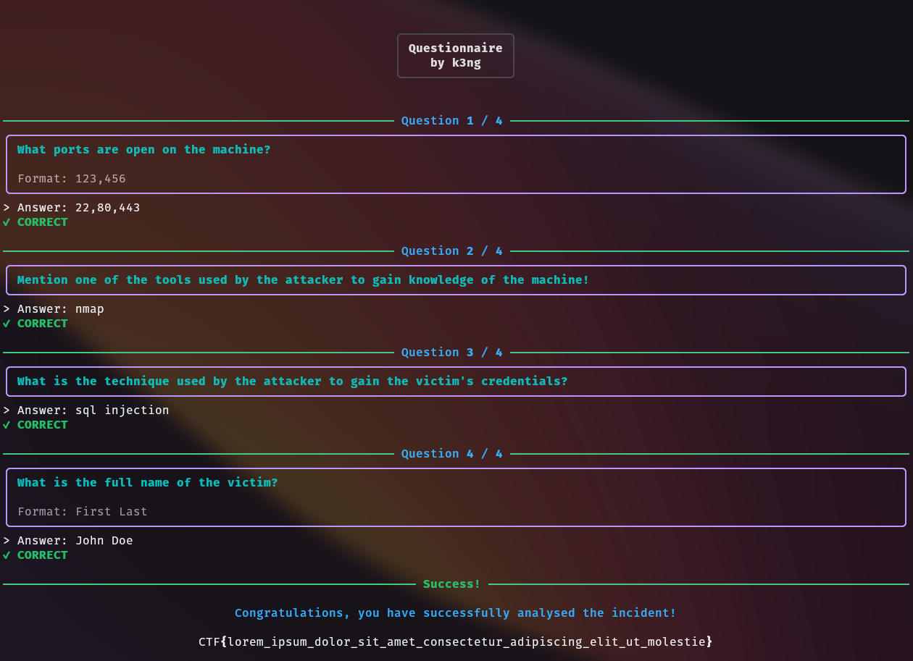

# questionnaire



A configurable terminal questionnaire for CTF challenges. It supports sections,
multiple accepted answers, unordered arrays, regular expressions, configurable
normalization, per-question notes, and custom Rich styling.

The flag is released only when every question is answered correctly. Skipped or
incorrect answers never reveal it.

## Run with Docker

```bash
docker run -d \
  --name questionnaire \
  --read-only \
  --pids-limit 128 \
  --memory 128m \
  --cpus 1 \
  -p 1337:1337 \
  -e FLAG="CTF{example_flag}" \
  -v "$(pwd)/config.yaml:/app/config.yaml:ro" \
  ghcr.io/kawijayaa/questionnaire
```

The container listens on port `1337`. It runs as an unprivileged user, limits
idle connections to 60 seconds, and accepts at most 100 concurrent child
connections. The additional `docker run` limits above are recommended for
internet-facing challenges.

`FLAG` is required for normal operation. It may be supplied through the
environment or a local `.env` file. Do not commit `.env`.

## Validate a configuration

Validation does not start the questionnaire and does not require `FLAG`:

```bash
python server.py --config config.yaml --validate-config
```

The command checks the YAML shape, question/answer types, regular expressions,
styles, borders, skip settings, and runtime limits. It exits nonzero when the
configuration is invalid.

The available command-line options are:

```text
python server.py [-c CONFIG] [--validate-config]
```

- `-c` / `--config` selects a YAML file. The default is `config.yaml`.
- `--validate-config` validates that file and exits without requiring `FLAG`.

## Upgrading from earlier versions

`can_skip` now allows an empty response to skip a question. It no longer means
“continue after an incorrect answer.” To preserve that older behavior, use:

```yaml
config:
  can_skip: false
  continue_on_incorrect: true
```

To enable both behaviors, set both values to `true`.

## Local development

```bash
git clone https://github.com/kawijayaa/questionnaire
cd questionnaire
python -m venv .venv
source .venv/bin/activate
pip install -r requirements.txt

export FLAG="CTF{local_dev_flag}"
python server.py
```

Run the test suite with:

```bash
python -m unittest discover -v
```

## Configuration structure

A file contains `config`, `ui`, and `theme` settings followed by exactly one
question source: either root-level `questions` or non-empty `sections`.
Unknown fields are rejected so spelling errors fail during validation.

For a questionnaire without named sections, use root-level questions:

```yaml
questions:
  - question: "What tool was used?"
    answer: "nmap"
```

Use sections when questions should be grouped or numbered per section:

```yaml
config:
  header_text: "Incident questionnaire"
  win_text: "Investigation complete."
  case_sensitive: false
  can_skip: true
  continue_on_incorrect: false
  array_delimiter: ","
  numbering: global
  max_answer_length: 4096
  regex_timeout_ms: 100
  normalization:
    trim_whitespace: true
    collapse_whitespace: false
    ignore_punctuation: false
    numeric_comparison: false
    array_duplicates: preserve

sections:
  - name: "Reconnaissance"
    style: "bold yellow"
    questions:
      - question: "Which ports were open?"
        answer: ["22", "80", "443"]
        config:
          type: array
          subtext: "Include every TCP port from the scan."
          format: "22,80,443"
```

### General settings

| Field | Default | Meaning |
| --- | --- | --- |
| `header_text` | `""` | Text displayed before the first section. |
| `win_text` | `""` | Text displayed before the flag. |
| `case_sensitive` | `true` | Global answer case sensitivity. |
| `can_skip` | `false` | Allows a blank or whitespace-only response to skip. |
| `continue_on_incorrect` | `false` | Continues after wrong answers instead of exiting immediately. |
| `array_delimiter` | `","` | Separator for array responses. |
| `numbering` | `global` | `global` or per-`section` numbering. |
| `max_answer_length` | `4096` | Maximum characters accepted in one response. |
| `regex_timeout_ms` | `100` | Maximum regex evaluation time in milliseconds. |

Skipping and continuing after an incorrect answer are independent. Either a
skipped or incorrect response prevents release of the flag and produces a
nonzero exit status.

| Situation | Result |
| --- | --- |
| Every answer is correct | Print the win text and flag; exit `0`. |
| User submits empty input and `can_skip` is enabled | Mark the question skipped, continue, withhold the flag; exit `1`. |
| Answer is wrong and `continue_on_incorrect` is `false` | Stop immediately, withhold the flag; exit `1`. |
| Answer is wrong and `continue_on_incorrect` is `true` | Ask the remaining questions, withhold the flag; exit `1`. |

### Question types

Each question has `question`, `answer`, and an optional `config` mapping.

```yaml
- question: "What tool was used?"
  answer: "nmap"

- question: "Name one accepted tool."
  answer: ["nmap", "masscan"]
  config:
    type: multi

- question: "List all open ports."
  answer: ["22", "80", "443"]
  config:
    type: array

- question: "What was the internal IP?"
  answer: "^192\\.168\\.[0-9]{1,3}\\.[0-9]{1,3}$"
  config:
    type: regex
```

| Type | Answer shape | Matching behavior |
| --- | --- | --- |
| `default` | String | One exact normalized value. |
| `multi` | List of strings | Any one normalized value may match. |
| `array` | List of strings | All delimited values must match; order does not matter. |
| `regex` | String | Matches from the start using the configured case mode and timeout. |

Question configuration fields are:

- `type`: `default`, `multi`, `array`, or `regex`.
- `case_sensitive`: optional override of the global setting.
- `subtext`: dimmed notes shown below the question.
- `format`: dimmed response-format guidance shown after the subtext.

For example:

```yaml
- question: "Which ports were open?"
  answer: ["22", "80", "443"]
  config:
    type: array
    subtext: "Include every TCP port reported by the scan."
    format: "22,80,443"
```

Configured question text, subtext, format hints, section names, win text, and
the flag are rendered as plain text rather than Rich markup.

### Answer normalization

Normalization applies to `default`, `multi`, and `array` questions:

- `trim_whitespace` removes leading and trailing whitespace.
- `collapse_whitespace` replaces each whitespace run with one space.
- `ignore_punctuation` removes characters in Unicode punctuation categories.
- `numeric_comparison` compares numeric-looking answers as decimal values, so
  `1`, `1.0`, and `1.00` are equal.
- `array_duplicates` is `preserve` to count duplicates or `ignore` to compare
  only unique array values.

For regex questions, only trimming and whitespace collapsing affect the input;
the pattern is never rewritten. Case-insensitive regexes use the engine's
case-insensitive flag. Punctuation removal, numeric comparison, and array
duplicate handling do not alter regex matching.

### UI and theme

```yaml
ui:
  panel_style: "magenta"
  header_style: "bold white"
  section_style: "bold yellow"
  border_type: "rounded"

theme:
  info: "italic cyan"
  error: "bold red"
  success: "bold green"
  question: "bold yellow"
  prompt: "bold magenta"
```

Supported borders are `rounded`, `heavy`, `square`, `double`, and `ascii`.
Rich styles are validated before the questionnaire begins. UI styles may refer
to the configured theme names.

## Operational safeguards

- User responses are length-limited before answer evaluation.
- Regex evaluation has a configurable timeout to reduce catastrophic
  backtracking risk.
- The container uses an unprivileged account, an inactivity timeout, and a
  concurrent connection limit.
- The publishing workflow runs unit tests and a built-container smoke test
  against the real TCP listener before pushing an image to GHCR.

These controls reduce risk but do not replace host-level CPU, memory, process,
and network limits for a publicly exposed CTF service.
